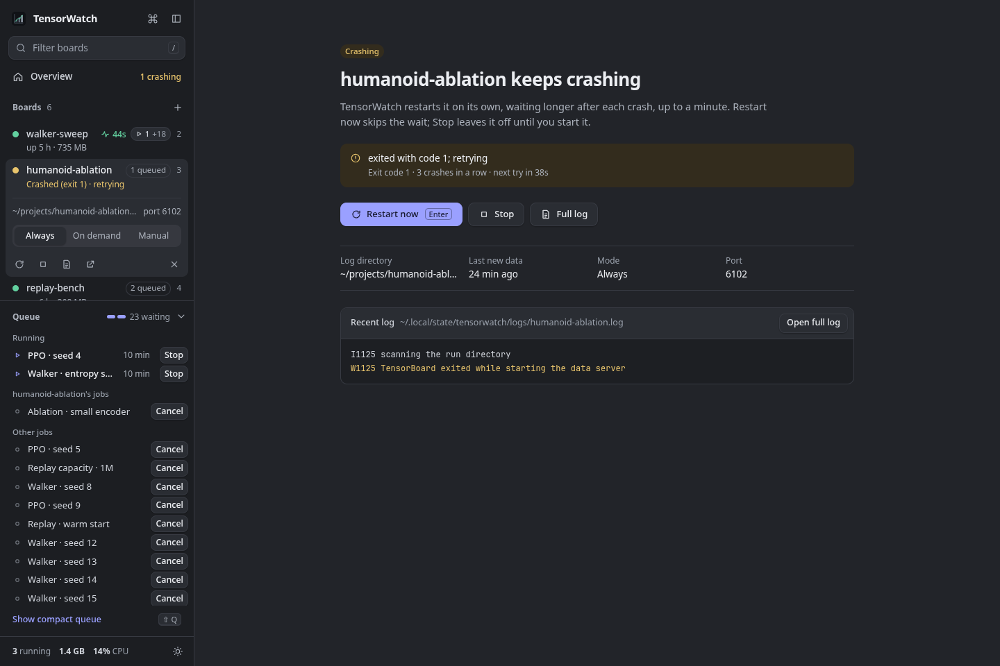

# TensorWatch

TensorWatch supervises TensorBoard on a Linux workstation. Register each
project's log directory once, then switch between boards in one dashboard.
A systemd user service brings your always-on boards back after a reboot. When
[mlq](https://github.com/CarsonBurke/mlqueue) is running, the dashboard also
shows which GPU jobs are writing to each board.

| Light overview | Dark board diagnostics |
| --- | --- |
|  |  |

The screenshots use example boards and jobs.

## Get started

TensorWatch needs Python 3.11+ and `tensorboard` on your PATH. Run these
commands from a TensorWatch checkout.

```bash
bin/tensorwatch add ~/projects/cleanrl/runs
bin/tensorwatch install
bin/tensorwatch open
```

`install` enables a systemd user service, enables linger so the service can start
before you sign in, and installs an app launcher and a `tensorwatch` command in
`~/.local/bin`. The dashboard is at <http://127.0.0.1:6005/> by default. To run
in the foreground without installing the service, use `bin/tensorwatch serve`.

### Add boards

Give `tensorwatch add` one or more logdirs. Point it at a shared `runs/` or
`tb_logs/` directory to see all the runs under it in one board. The command
derives a board name from the repository, assigns a port, and reports if the
path is already registered or has no event files yet.

```bash
tensorwatch scan ~/projects/cleanrl
tensorwatch add ~/projects/cleanrl/runs_old --autostart on_demand
tensorwatch list
```

`scan` previews directories containing TensorBoard events. Add the paths you
want individually, or pass `--add` to the scan to register every new match.
In the dashboard, **Add board** offers path completion and finds unregistered
logdirs near your existing boards. Press `Tab` to accept a directory and descend
into it.

Agents working in this checkout can use the
[add-to-tensorwatch skill](.agents/skills/add-to-tensorwatch/SKILL.md).

### Choose when a board runs

| Policy | When it runs |
| --- | --- |
| **Always** | Starts with the service and retries after a crash. Default. |
| **On demand** | Starts when a dashboard pane opens it and stops after 15 minutes idle by default. |
| **Manual** | Starts when you open it, press Start, or run `tensorwatch start NAME`. |

Change the policy in the open board's sidebar row, its `⋯` menu, or with
`tensorwatch set NAME autostart=on_demand`. The choice is stored in the
registry. Use **On demand** for archives you open occasionally.

## Dashboard

The overview shows running boards, new event data, boards that need attention,
and the mlq queue. Open a board to see its TensorBoard pane. The sidebar row
expands to show the logdir, port, policy, and controls. Click the logdir to copy
it, or right-click a row for its actions.

A board that is starting, stopped, or crashing shows its status and recent
logs. A crash page includes the next retry time and points out recognizable
log messages, such as a port in use or a file descriptor limit.

The theme follows the system until you switch it in the sidebar footer.
The dashboard follows the system's reduced-motion setting.

When mlq is available, the sidebar lists running jobs first, then waiting jobs
for the open board. Select **Show full queue** or press `Shift`+`Q` to expand
the list and show job controls in the sidebar. Stop and cancel actions take a
second click.

Removing a board unregisters it and leaves its logdir on disk. Use the **Undo**
toast to restore the registry entry, including its port and comments.

| Key | Action |
| --- | --- |
| `Ctrl`+`K` | Search boards, jobs, and actions. `Shift`+`Enter` opens a board in its own window. |
| `/` | Filter boards. Number shortcuts follow the filtered list. |
| `1`–`9`, `Ctrl`+`1`–`0` | Open a board |
| `g` | Show the overview |
| `w` / `d` / `l` | Close and unload the open board / open it in its own window / view its log |
| `Shift`+`R` | Reload the open board's pane |
| `Enter` | Run the primary action on a board's status page |
| `+` / `Delete` | Add a board / remove the focused board |
| `q` / `Shift`+`Q` | Fold the sidebar queue / toggle the full list |
| `[` | Collapse the sidebar to status dots |
| `r` / `Esc` | Reload the registry / close the topmost menu, sheet, or panel |

## Registry

The registry lives at `~/.config/tensorwatch/config.toml`. Commands such as
`add`, `rm`, and `set` preserve comments when they edit it. After a manual edit,
press `r` in the dashboard or run `systemctl --user reload tensorwatch`.

```toml
[server]
port = 6005
port_base = 6100

[defaults]
reload_interval = 60

[[board]]
name = "cleanrl"
logdir = "~/projects/cleanrl/runs"
port = 6100
autostart = "always"
```

A board's port is stored in the registry. TensorBoard keeps pins and settings
per browser origin, so changing a board's port leaves its saved UI state on
the old port.

Board settings include `logdir_spec`, `samples_per_plugin`, `args`, `command`,
`cwd`, `env`, `description`, `enabled`, and `idle_timeout`. The dashboard keeps
two TensorBoard panes mounted by default. Set `[server] keep_warm` to change it.
Set `[queue] enabled = false` and restart the service to hide mlq.

## CLI reference

| Command | Use |
| --- | --- |
| `add PATH…` / `rm NAME…` | Register logdirs / unregister by name or logdir |
| `scan DIR [--add]` | Preview logdirs or register all new matches |
| `list` / `status [NAME]` | List registered boards / see live status |
| `set NAME KEY=VALUE …` | Change board settings |
| `enable NAME` / `disable NAME` | Enable or disable supervision while keeping the registry entry |
| `start NAME` / `stop NAME` / `restart NAME` | Control a board |
| `logs NAME [-f]` | Read or follow a board's TensorBoard output |
| `open [NAME]` | Open the dashboard or a board in an app window |
| `queue` | Show the mlq queue as TensorWatch sees it |
| `install` / `uninstall` | Manage the user service and launcher |
| `serve` | Run the supervisor and dashboard in the foreground |
| `doctor` | Check registry settings, ports, commands, and logdirs |

Run `tensorwatch <command> --help` for flags.

## Troubleshooting

- Run `tensorwatch doctor` if a board cannot start. Read board logs with
  `tensorwatch logs NAME` and service logs with `journalctl --user -u tensorwatch`.
- For boards with thousands of event files, check the file descriptor limit.
  The installed service sets `LimitNOFILE=65536`. A low limit can leave
  TensorBoard showing “No dashboards are active for the current data set.”
- TensorWatch and TensorBoard bind to loopback by default and have no
  authentication. Listening beyond loopback requires
  `[server] allow_remote = true`.
- Run `python3 -m pytest tests -q` from the checkout to run the tests.
