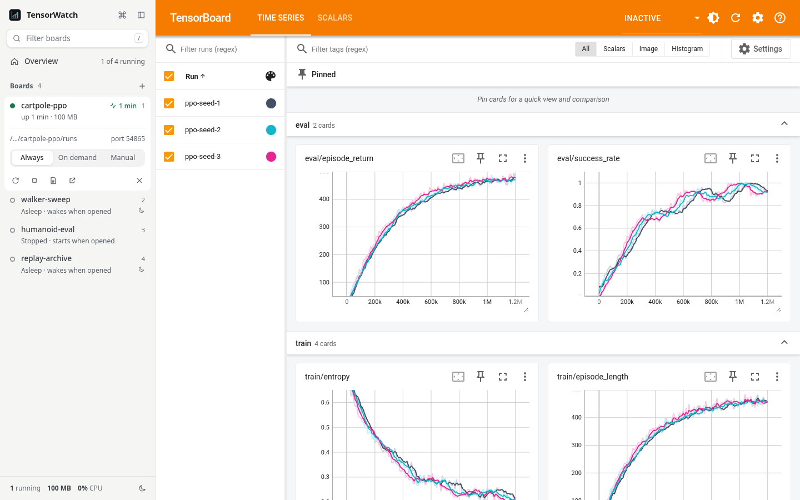
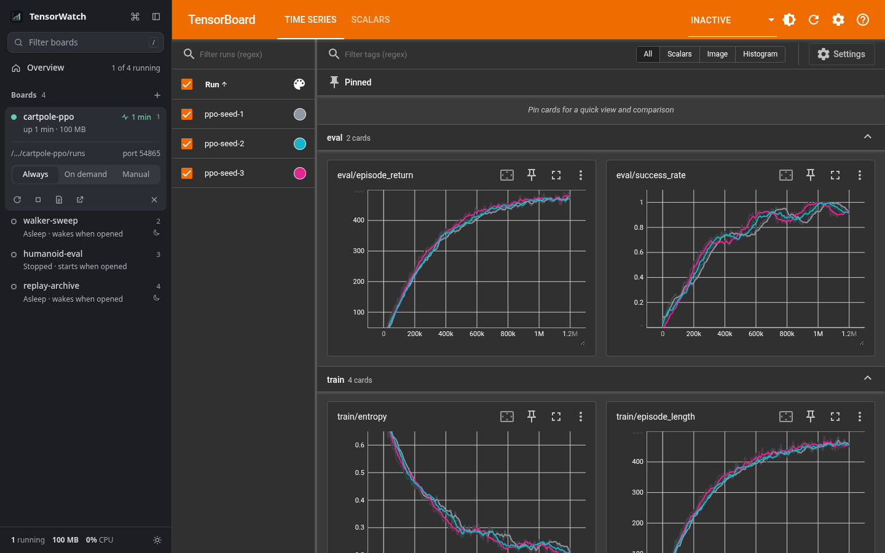

# TensorWatch

Keep your projects' TensorBoards in one window. Register each project's log
directory once, then pick a board from the sidebar to open its charts.
TensorWatch runs locally on Linux and manages the TensorBoard processes. It
runs only while one of its windows is open. It can also show the boards and
mlq queue of other machines you reach over SSH, in the same window.

**Light**



**Dark**



Both screenshots show TensorBoard rendering example runs.

## Get started

TensorWatch needs Python 3.11+ and `tensorboard` on your PATH. Run these
commands from a TensorWatch checkout.

```bash
bin/tensorwatch add ~/projects/cleanrl/runs
bin/tensorwatch install
bin/tensorwatch open
```

`install` enables a systemd user socket on the dashboard port, and installs an
app launcher and a `tensorwatch` command in `~/.local/bin`. The dashboard is at
<http://127.0.0.1:6005/> by default.

The first connection to the dashboard port starts TensorWatch. That connection
can come from the launcher, a bookmark, or the CLI. TensorWatch stops its boards
and exits two minutes after the last window closes. Set `[server] idle_exit` in
seconds to change the delay. Without systemd, `tensorwatch open` starts
TensorWatch in the background, and it exits the same way. To keep TensorWatch
running until you stop it, run `bin/tensorwatch serve` in a terminal. If the
socket is installed, stop it first with `systemctl --user stop tensorwatch.socket`.

### Add boards

Give `tensorwatch add` one or more logdirs. Point it at a shared `runs/` or
`tb_logs/` directory to see all the runs under it in one board. The command
derives a board name from the repository, assigns a port, and reports if the
path is already registered or has no event files yet.

```bash
tensorwatch scan ~/projects/cleanrl
tensorwatch add ~/projects/cleanrl/runs_old --autostart on_demand
tensorwatch list
```

`scan` previews directories containing TensorBoard events. Add the paths you
want individually, or pass `--add` to the scan to register every new match.
In the dashboard, **Add board** offers path completion and finds unregistered
logdirs near your existing boards. Press `Tab` to accept a directory and descend
into it.

Agents working in this checkout can use the
[add-to-tensorwatch skill](.agents/skills/add-to-tensorwatch/SKILL.md).

### Choose when a board runs

| Policy | When it runs |
| --- | --- |
| **Always** | Starts when TensorWatch starts and retries after a crash. Default. |
| **On demand** | Starts when a dashboard pane opens it and stops after 15 minutes idle by default. |
| **Manual** | Starts when you open it, press Start, or run `tensorwatch start NAME`. |

Change the policy in the open board's sidebar row, its `⋯` menu, or with
`tensorwatch set NAME autostart=on_demand`. The choice is stored in the
registry. Use **On demand** for archives you open occasionally.

## Work with boards

Pick a board in the sidebar or press its number to switch to it. The selected
row shows the logdir, port, run policy, and controls. Click the logdir to copy
it, or press `d` to open the board in its own window. That window also keeps
TensorWatch running, so you can close the dashboard and keep the board open.

Each board has its own address on the dashboard port, such as
`http://cleanrl.localhost:6005/`, and TensorWatch relays it to that board's
TensorBoard. A browser tab opened at that address does not keep TensorWatch
running, so the board stops when the last TensorWatch window closes.

The theme follows the system until you switch it in the sidebar footer.
The dashboard follows the system's reduced-motion setting.

When [mlq](https://github.com/CarsonBurke/mlqueue) is running, the sidebar
shows running GPU jobs and which boards they belong to. Select **Show full
queue** or press `Shift`+`Q` to expand the list and its controls inside the
sidebar. Stop and cancel actions take a second click.

Removing a board unregisters it and leaves its logdir on disk. Use the **Undo**
toast to restore the registry entry, including its port and comments.

| Key | Action |
| --- | --- |
| `Ctrl`+`K` | Search boards, jobs, and actions. `Shift`+`Enter` opens a board in its own window. |
| `/` | Filter boards. Number shortcuts follow the filtered list. |
| `1`–`9`, `Ctrl`+`1`–`0` | Open a board |
| `w` / `d` / `l` | Close and unload the open board / open it in its own window / view its log |
| `Shift`+`R` | Reload the open board's pane |
| `+` / `Delete` | Add a board / remove the focused board |
| `q` / `Shift`+`Q` | Fold the sidebar queue / toggle the full list |
| `[` | Collapse the sidebar to status dots |
| `r` / `Esc` | Reload the registry / close the topmost menu, sheet, or panel |

## Watch another machine

If your runs train on another machine, register it as a remote. Its boards
and queue then appear in this machine's window, grouped under its name.

```bash
tensorwatch remote add nvidia-desktop --ssh desktop --label "NVIDIA desktop"
```

`--ssh` takes anything `ssh` accepts, usually a `Host` alias from
`~/.ssh/config`, which supplies the user, key, port and jump hosts. The name
(`nvidia-desktop`) appears in board addresses, and the label is what the sidebar
shows. `remote add` connects once to check the setup, and the remote stays
registered either way. For the check to pass:

- `ssh desktop true` must log in without prompting, with a key or an agent.
  TensorWatch runs ssh with `BatchMode`, so it never asks for a password.
- TensorWatch must be installed on the remote (`tensorwatch install`), at a
  version that supports remotes. Updating it there and restarting it with
  `systemctl --user restart tensorwatch` fixes a "too old" error. If the remote's
  login shell can't find `tensorwatch` or `~/.local/bin/tensorwatch`, set
  the path with `tensorwatch remote set nvidia-desktop --command /path/to/tensorwatch`.

TensorWatch opens one SSH connection per remote while a window is open on
this machine. It closes the connection `idle_exit` seconds after the last
window closes. While you watch, the remote's TensorWatch and the on-demand
boards you open stay up as if you were sitting at it. A remote board is at
`http://BOARD.REMOTE.localhost:6005/`. `tensorwatch open BOARD@REMOTE` opens
it in its own window. Queue controls act on the remote's mlq. If a remote
can't be reached, its sidebar group says why (unreachable, SSH login refused,
untrusted host key, TensorWatch missing or too old) and offers **Retry**.
`tensorwatch remote check` runs the same connection from the terminal.

A machine with no boards of its own works too: it shows only its remotes.

For a one-off look without registering a remote, a single tunnel to the
dashboard port is enough, because every board is served on it:

```bash
ssh -L 6005:127.0.0.1:6005 desktop
```

Then open <http://localhost:6005/> on the machine running the tunnel.

## Registry

The registry lives at `~/.config/tensorwatch/config.toml`. Commands such as
`add`, `rm`, and `set` preserve comments when they edit it. After a manual edit,
press `r` in the dashboard or run `systemctl --user reload tensorwatch`. If
TensorWatch is not running, it reads the edit when it next starts. After you
change `[server] port`, run `tensorwatch install-service` so the socket listens
on the new port.

```toml
[server]
port = 6005
port_base = 6100

[defaults]
reload_interval = 60

[[board]]
name = "cleanrl"
logdir = "~/projects/cleanrl/runs"
port = 6100
autostart = "always"

[[remote]]
name = "nvidia-desktop"
ssh = "desktop"
label = "NVIDIA desktop"
```

A board's port is stored in the registry and stays internal: browsers reach
the board through the dashboard port. TensorBoard keeps pins and settings per
browser origin, which is the board's name, so renaming a board leaves its saved
UI state under the old name. Settings saved before TensorWatch served boards
this way stay with the old direct port addresses and aren't carried over.

A remote's settings are `name`, `ssh`, `label`, `command` (how its shell runs
TensorWatch, `tensorwatch` by default), and `enabled`.

Board settings include `logdir_spec`, `samples_per_plugin`, `args`, `command`,
`cwd`, `env`, `description`, `enabled`, and `idle_timeout`. The dashboard keeps
two TensorBoard panes mounted by default. Set `[server] keep_warm` to change it.
Set `[queue] enabled = false` and restart TensorWatch to hide mlq.

## CLI reference

| Command | Use |
| --- | --- |
| `add PATH…` / `rm NAME…` | Register logdirs / unregister by name or logdir |
| `scan DIR [--add]` | Preview logdirs or register all new matches |
| `list` / `status [NAME]` | List registered boards / see live status |
| `set NAME KEY=VALUE …` | Change board settings |
| `enable NAME` / `disable NAME` | Enable or disable supervision while keeping the registry entry |
| `start NAME` / `stop NAME` / `restart NAME` | Control a board |
| `logs NAME [-f]` | Read or follow a board's TensorBoard output |
| `open [NAME \| NAME@REMOTE]` | Open the dashboard or a board in an app window |
| `queue` | Show the mlq queue as TensorWatch sees it |
| `remote add NAME --ssh DEST [--label TEXT]` | Register another machine and check the connection |
| `remote list` / `remote check [NAME…]` | List remotes and their state / connect once and report |
| `remote set NAME [--ssh] [--label] [--command] [--enable \| --disable]` | Change a remote |
| `remote rm NAME…` | Unregister remotes |
| `install` / `uninstall` | Manage the systemd socket and the launcher |
| `serve` | Run TensorWatch in the foreground until you stop it |
| `doctor` | Check registry settings, ports, commands, and logdirs |

Run `tensorwatch <command> --help` for flags.

## Troubleshooting

- Run `tensorwatch doctor` if a board cannot start. Read board logs with
  `tensorwatch logs NAME`. Read TensorWatch's own log with
  `journalctl --user -u tensorwatch`, or in
  `~/.local/state/tensorwatch/logs/manager.log` if TensorWatch runs without
  systemd.
- For boards with thousands of event files, check the file descriptor limit.
  The installed service sets `LimitNOFILE=65536`. A low limit can leave
  TensorBoard showing “No dashboards are active for the current data set.”
- TensorWatch and TensorBoard bind to loopback by default and have no
  authentication. Listening beyond loopback requires
  `[server] allow_remote = true`. To use TensorWatch from another machine,
  prefer a remote or an SSH tunnel. TensorWatch answers only loopback names
  (`localhost`, `*.localhost`, `127.0.0.1`, `[::1]`), so a web page can't reach
  it through DNS rebinding. Each board is its own origin, so one board's page
  can't read another board or drive TensorWatch.
- If a remote shows as unreachable, run `tensorwatch remote check NAME` for
  ssh's own error, and `ssh DEST true` to try the login by hand.
- Run `python3 -m pytest tests -q` from the checkout to run the tests.
