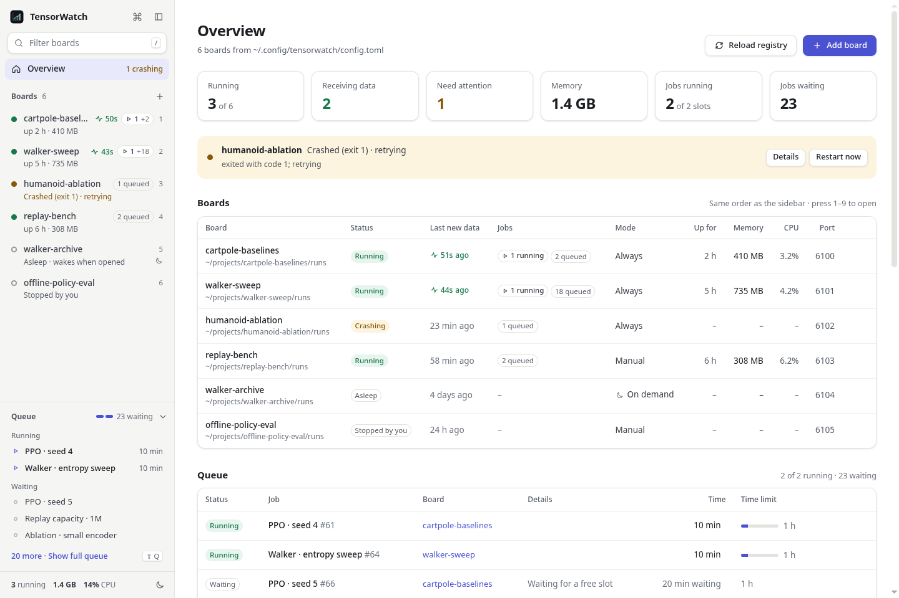

# TensorWatch

A local supervisor for TensorBoard.

You train across several repos, each with its own `runs/` (or `tb_logs/`, …).
Starting `tensorboard --logdir …` by hand for each one does not scale: ports
get forgotten, processes die on reboot, and you end up with a pile of tabs.

1. Register each logdir once (`~/.config/tensorwatch/config.toml`).
2. A `systemd --user` service keeps one TensorBoard process per board.
3. One dashboard at `http://127.0.0.1:6005/` lists them and embeds the one
   you pick.

If [mlq](https://github.com/CarsonBurke/mlqueue) is running, the GPU queue
shows up in the same sidebar, tagged with the board each job writes to.



The screenshots use example boards and jobs.

It is a single-user Linux workstation tool. Everything binds loopback. There
is no authentication. It is not a TensorBoard fork and not a remote service.

## Install

Needs Python 3.11+ and `tensorboard` on `PATH`. No other Python packages.

```bash
cd tensorwatch
bin/tensorwatch add ~/Documents/repositories/cleanrl/runs
bin/tensorwatch scan ~/Documents/repositories --add   # find more logdirs
bin/tensorwatch install
bin/tensorwatch open
```

`install` writes `~/.config/systemd/user/tensorwatch.service`, enables linger
so boards start at boot, adds a desktop launcher, and puts `tensorwatch` on
`PATH` (`~/.local/bin`). After that, open it from the app menu or
`tensorwatch open`.

Without systemd: `tensorwatch serve` (optionally `--window`).

## Daily use

```bash
tensorwatch add ~/path/to/runs          # register (several paths at once is fine)
tensorwatch rm cleanrl                  # unregister, by name or by logdir
tensorwatch list                        # registry + live state
tensorwatch open                        # dashboard window
tensorwatch open cleanrl                # that board only
tensorwatch set cleanrl autostart=on_demand
tensorwatch logs cleanrl -f
tensorwatch doctor
```

`scan` walks a tree for `events.out.tfevents*` files and groups them: a
`runs/` or `tb_logs/` directory becomes one board, not one per timestamped run,
and is probed rather than walked, so a logdir with thousands of runs costs the
same as one with three.

`add` names a board after its repository (`cleanrl/runs` is `cleanrl`, a second
logdir there is `cleanrl-runs_old`), refuses a logdir that already is a board,
and says so when the directory holds no event files yet.

## Registry

Hand-editable TOML at `~/.config/tensorwatch/config.toml`. `add` / `rm` /
`set` / `scan` edit it in place (comments and formatting stay). Reload with
`r` in the dashboard or `systemctl --user reload tensorwatch`.

```toml
[server]
port = 6005          # dashboard
port_base = 6100     # first auto-assigned board port (6006–6010 left free)

[defaults]
reload_interval = 60

[[board]]
name = "cleanrl"
logdir = "~/Documents/repositories/cleanrl/runs"
port = 6100
autostart = "always"              # always | on_demand | manual
```

Useful extras on a board: `logdir_spec`, `samples_per_plugin`, `args`,
`command` (launcher other than `tensorboard`), `cwd`, `env`, `description`,
`enabled`, `idle_timeout`. `[queue] enabled = false` hides the mlq panel.

Ports are sticky. TensorBoard stores pins and UI state per origin, so an
auto-assigned port is written back and never reused for a different logdir.
Changing a board's port by hand leaves its saved UI on the old one.

## Autostart

| Policy | When it runs |
| --- | --- |
| `always` | With the service, restarted forever. Default. |
| `on_demand` | When you open it; stopped after 15 min idle. Use for huge archives. |
| `manual` | Only `tensorwatch start NAME` or the dashboard button. |

The open board's row in the dashboard has an **Always / On demand / Manual**
switch, and the `⋯` menu offers the same choice for any board. It writes the
registry, so the choice survives a restart, and the new policy takes over at
once: an on-demand board keeps one idle window and then stops, an always board
comes back up.

## Commands

| Command | |
| --- | --- |
| `add PATH…` | Register one or more logdirs |
| `rm NAME…` | Unregister, by name or by logdir |
| `set NAME KEY=VALUE …` | Change a board (`autostart=on_demand`, `port=6104`, …) |
| `enable` / `disable NAME` | Leave it in the file, stop supervising it |
| `scan DIR [--add]` | Discover logdirs |
| `list` / `status [NAME]` | Registry / live state |
| `start` / `stop` / `restart NAME` | Control a running board |
| `logs NAME [-f]` | That board's TensorBoard output |
| `open [NAME]` | Dashboard (or one board) in an app window |
| `queue` | mlq queue as the dashboard sees it |
| `doctor` | Registry, ports, commands, missing logdirs |
| `serve` | Supervisor + dashboard in the foreground |
| `install` / `uninstall` | Service, launcher, PATH symlink |

`tensorwatch <cmd> -h` for flags.

## Dashboard

The sidebar lists boards in registry order, so their numbers never move. Each
row says what the board is doing in plain words: `up 3 h · 412 MB`,
`Asleep · wakes when opened`, `Crashed (exit 1) · retrying`,
`up 6 min · sleeps in 9 min`. A green pulse with an age means new event data
is arriving, and a pill counts the board's mlq jobs (`▶ 1 +2`: one running, two
waiting). Opening a board expands its row with the logdir (click to copy), the
port, the policy switch and its actions. Right-click a row, or use its `⋯`
button or `Shift`+`F10`, for everything else.

With nothing open, the main area is an **Overview**: totals, a card for each
board that needs attention, every board in a table, and the queue. A board that
isn't serving gets its own page instead of a broken frame: crashing (with a
live countdown to the next try), can't start (missing logdir, port taken),
waking up, asleep, stopped or disabled. Each page shows the recent log and,
where the message, exit code or log gives it away, a likely cause and how to
check it (out of open files, killed by the OOM killer, port in use).


The sidebar's queue shows running jobs, then the open board's waiting jobs,
then others up to `[queue] visible`. `Shift`+`Q` opens the full queue below
the board, where stopping or cancelling a job takes a second click.

| Key | |
| --- | --- |
| `Ctrl`+`K` | Search boards, jobs and actions (`Shift`+`Enter` opens a board in its own window) |
| `/` | Filter the sidebar; digits follow the filtered list |
| `1`–`9`, `Ctrl`+`1`–`0` | Open a board |
| `g` | Overview |
| `w` / `d` / `l` | Close and unload the open board / own window / its log |
| `Shift`+`R` | Reload the open board's pane |
| `Enter` | On a status page: restart, try again or start |
| `+` | Add a board |
| `Delete` | Remove the focused board |
| `q` / `Shift`+`Q` | Fold the sidebar queue / open the full queue |
| `[` | Collapse the sidebar to status dots |
| `r` | Reload the registry |
| `Esc` | Close the topmost menu, sheet or panel |

The theme follows the system; the button in the sidebar footer switches it, and
the choice is remembered in the browser. The dashboard respects the system's
reduced-motion preference.

**Adding.** The logdir field completes directories as you type (`Tab` accepts
and descends, `↑`/`↓` choose) and marks the ones that hold runs. Name and
policy are optional. Below the form, "Found near your boards" lists
unregistered logdirs in the repositories next to the ones you already watch;
each can be added with one click.

**Removing** asks nothing and is undoable: the confirmation offers `Undo` for a
few seconds, which puts the board's registry block back where it was, port and
comments included. Several removals can be undone in any order. The removed
block stays inside the manager and the dashboard only holds a token for it, so
the unauthenticated API never accepts registry text.

"New data" is the newest `events.out.tfevents*` write under a board's logdir,
so it counts any run under `runs/` no matter who started it.

The dashboard only keeps a few TensorBoard UIs mounted (`keep_warm`, default
2); `w` unloads one right away. The processes themselves follow each board's
autostart policy.

## Notes

- Loopback only. A non-loopback `host` or `--bind_all` is rejected unless
  `[server] allow_remote = true`. TensorBoard has no auth.
- State and logs: `~/.local/state/tensorwatch/`.
- TensorBoard opens one file per event file, so the service sets
  `LimitNOFILE=65536`. With the usual 1024 a board with thousands of runs loads
  nothing and says "No dashboards are active for the current data set";
  `doctor` flags that.
- Tests: `python3 -m pytest tests -q`.
